# Réécriture de Synthé3-ng en C : architecture, changements et validation

Ce dossier décrit le passage de la chaîne C++/Python de **Synthé3-ng** à son moteur
C11, puis le renforcement des interruptions pour Speech Dispatcher et Orca.
Travaux et mesures réalisés le **25 octobre 2026**. Il accompagne la version
`0.3.0` du paquet ng.

L’objectif était de conserver la voix Michel et les réglages sonores de ng,
tout en supprimant Python à l’exécution, les WAV temporaires, les sous-processus
par fragment et les threads de synthèse créés à chaque parole. La variante historique reste dans le dépôt de travail, hors de ce paquet autonome.

Les résultats historiques sont enregistrés dans
[benchmarks/2026-10-25.json](benchmarks/2026-10-25.json). Ce fichier transcrit les
mesures effectivement obtenues pendant le travail ; il ne contient pas de
résultats simulés. Les commandes ci-dessous permettent de refaire les contrôles.

## Résultats principaux

| Point | Résultat constaté |
| --- | --- |
| Exécution ng | Un module C persistant lié à `libspeechd_module`, sans interpréteur Python |
| Créations pendant la parole | Aucun enfant ni thread du module lors du traçage |
| Fichiers audio | Aucun WAV, aucune ouverture en écriture par le module tracé |
| Fidélité | 40 cas de référence produisent le même PCM final que l’ancienne chaîne ng |
| CPU, première comparaison | 5,7162 s → 0,0558 s pour dix lectures, soit environ 102 fois moins de temps CPU |
| Interruptions directes | Maximum affiché d’environ 2,0 ms sur 60 rafales STOP/reprise |
| Interruptions via le serveur | Maximum de 10,6 ms jusqu’à la notification d’annulation sur la dernière série de 30 cycles |
| Reprise via le serveur | Maximum de 0,4 ms jusqu’à la notification de début du message suivant |
| Préemption par priorité | Maximum de 6,8 ms jusqu’au début du message prioritaire, sur cinq essais |
| Pause/reprise | Trois cycles réussis avec les marqueurs générés par Speech Dispatcher |
| Validation automatisée finale | 20 méthodes de test réussies, dont 40 comparaisons PCM ; construction Nix ng réussie |

Ces nombres décrivent cette machine et ces séries. Les notifications du serveur
ne constituent pas une mesure acoustique au haut-parleur. Le temps CPU ne mesure
pas directement des watts ou des joules.

## 1. Ancienne chaîne et nouvelle architecture

Avant la réécriture, le module Python découpait le texte, lançait le renderer C++
pour chaque fragment, attendait son WAV, puis le relisait et appliquait le DSP en
Python. Le moteur historique créait aussi son thread de synthèse. La validation
initiale produisait elle-même un WAV d’essai. Une demande d’arrêt devait notamment
interrompre le processus renderer en cours.

```mermaid
flowchart TD
    subgraph Avant[Ancien ng]
        A[Module Python] --> B[Processus renderer C++ par fragment]
        B --> C[WAV temporaire]
        C --> D[Lecture et DSP Python]
        D --> E[PCM vers Speech Dispatcher]
    end
    subgraph Maintenant[Module C persistant]
        F[libspeechd_module : commandes] --> G[Normalisation et SSML]
        G --> H[Phonétisation et diphones historiques]
        H --> I[PCM natif en mémoire à 10 kHz]
        I --> J[DSP C et sinc à 22 050 Hz]
        J --> K[libspeechd_module : paquets audio]
    end
```



Speech Dispatcher reste responsable de la lecture matérielle, de la file audio,
des priorités et de ses propres processus/threads. L’absence de nouveaux threads
et sous-processus concerne **le module ng**, pas l’ensemble du serveur, du client
de test ou de la pile audio.

### Répartition du code

| Fichier | Responsabilité |
| --- | --- |
| [src/engine.c](../src/engine.c) | Conversion alphabétique/phonétique, nombres, tables, assemblage des diphones et filtre historique ; PCM mono 16 bits à 10 000 Hz |
| [src/voice_data.h](../src/voice_data.h) | Adresses, segments Michel et tables historiques intégrés dans des tableaux constants |
| [src/dsp.c](../src/dsp.c) | Trois biquads, normalisation, fondus, interpolation sinc, gain final et volume |
| [src/module.c](../src/module.c) | Adaptation à l’API native des modules, normalisation du texte, SSML, marqueurs et annulation |
| [src/compat/spd_audio.h](../src/compat/spd_audio.h) | Inclusion des types audio publics pour les installations 0.12 dont l’en-tête de module référence un en-tête privé absent |
| [Makefile](../Makefile) | Construction C11, archive du moteur, tests, sanitizers et installation |

Le module **fournit une voix** à Speech Dispatcher : il utilise donc
`libspeechd_module`. `libspeechd` est la bibliothèque des **clients** ; elle sert
au test d’intégration natif, pas au moteur. Le protocole et l’échappement binaire
des paquets audio sont gérés par la bibliothèque installée, sans copie locale de
son implémentation.

## 2. Inventaire des changements

| Élément | Avant | Après |
| --- | --- | --- |
| Module de sortie | `src/sd_synthe3.py` | `src/module.c`, binaire `sd_synthe3_ng` |
| Traitement audio | `src/synthe3_ng.py` | `src/dsp.c` |
| Renderer | `render.cpp`, exécutable séparé | Appel synchrone direct à `s3_render` |
| Moteur historique | Classes et fichiers C++ de ng | Portage en fonctions et état privé C dans `engine.c` |
| Sortie matérielle historique | Stub `no_audio.cpp` et code ancien | Retirés du module ng |
| Stockage intermédiaire | Répertoire temporaire et WAV par parole | Tampons PCM en mémoire |
| Voix et tables | Ouvertes par chaque renderer | Tableaux constants du binaire |
| Arrêt | Gestion du subprocess Python | Annulation coopérative dans le même processus |
| Compilation | Compilateur C++ et pthread pour ng | Compilateur C11 ; aucune création de thread par ng |
| Configuration ng | Chemins `Renderer` et `DataDirectory` | Fichier vide ou commenté ; anciennes options refusées |
| Distribution Nix | Wrapper Python pour ng | Binaire natif, dépendances Speech Dispatcher/libxml2 |
| Outils d’essai | Démonstration des modules Python | Démonstration adaptée au binaire et test silencieux d’interruptions |

Les sources C++ et anciens scripts de construction ont été retirés de
`upstream`. Les ressources Michel, les licences et la documentation historique
restent disponibles. Le moteur historique complet reste disponible dans le dépôt d’origine.
Les modifications du test d’isolation adaptent le sabotage de la copie ng aux
nouveaux fichiers C ; elles ne changent pas le moteur original.

## 3. Conservation du timbre et du comportement sonore

### Moteur et données

Le portage conserve les règles de phonétisation, la lecture des nombres, les
liaisons, les courbes d’amplitude, les segments Michel et leur assemblage. Il
reprend les calculs de `SynTrans.cpp`, `SynParle.cpp`, `SynVoix.cpp` et
`SynCalcul.cpp`, sans nouveau modèle vocal. Le filtre historique des basses à
400 Hz, sa constante π historique et ses arrondis sont conservés.

Les octets intégrés correspondent exactement à :

- `Michel.seg` : table d’adresses puis segments, après les quatre octets de dimensions ;
- `Synthe.tab` : fichier complet, y compris son en-tête d’adresses.

Un test compare les tableaux intégrés aux fichiers sources. Les valeurs 16 bits
sont lues explicitement en little-endian, sans accès non aligné ni soustraction
d’un pointeur hors de son allocation.

Les marqueurs automatiques de mots du moteur historique sont reproduits avant
la phonétisation : ils peuvent influencer les règles, même si les marqueurs
Orca sont traités séparément par le module.

Les nœuds texte et CDATA du SSML alimentent désormais un tampon commun de
240 octets Latin-1. Un marqueur ou un changement de nœud XML ne déclenche plus
un rendu séparé : les marqueurs avant chaque mot ne multiplient donc plus les
fondus et les normalisations. Le PCM reste identique à celui du texte sans
marqueurs, y compris sur plusieurs fragments.

Le moteur mémorise les positions PCM de ses indices de mots historiques sans
modifier la phonétisation. Le module convertit ces positions de 10 000 à
22 050 Hz et découpe les paquets audio pour y intercaler les notifications,
sans silence ni fondu supplémentaire. Ce repérage suit les frontières de
diphones et reste approximatif, notamment à l’intérieur d’un mot. Les marqueurs
adjacents conservent leur ordre ; PAUSE s’applique au marqueur `__spd_` atteint,
sans émission audio après celui-ci.

### Chaîne DSP conservée

| Étape | Réglage |
| --- | --- |
| Synthèse source | Mono, PCM 16 bits, 10 000 Hz, volume interne historique 10 |
| Hauteur au réglage Speech Dispatcher 0 | Niveau historique 5 (ancien défaut : 6) |
| Égalisation de chaleur | 750 Hz, +1 dB, Q = 0,8 |
| Égalisation d’atténuation | 2 800 Hz, −1 dB, Q = 0,8 |
| Égalisation de présence | 3 600 Hz, +3 dB, Q = 0,7 |
| Première normalisation | Gain maximal 1 ; crête ramenée à 32 760 si nécessaire |
| Bords du fragment | Fondu de 2 ms à 10 kHz, soit 20 échantillons au maximum par bord |
| Reconstruction | Sinc à fenêtre Blackman, 48 coefficients, rayon 24, coupure relative 0,94 |
| Sortie | 22 050 Hz ; 441 phases pour le rapport 10 000/22 050 |
| Seconde normalisation | Gain maximal 1 ; crête ramenée à 32 760 si nécessaire |
| Gain fixe ng | 0 dB après la seconde normalisation, avant arrondi et volume client |
| Volume du client | Facteur `(volume + 100) / 100`, saturation au domaine PCM 16 bits |

Les coefficients des biquads et les 441 jeux de poids sinc sont calculés une seule
fois à l’initialisation. Les biquads et le rééchantillonnage utilisent des doubles.
Les arrondis au pair reproduisent ceux de Python. `-ffp-contract=off` empêche les
contractions flottantes de changer ces résultats et `-fsigned-char` conserve les
sentinelles et codes signés historiques, notamment sur les cibles où `char`
pourrait être non signé.

L’extension expérimentale de bande a été supprimée : elle était **déjà désactivée**
dans la version ng servant de référence. Le portage n’ajoute donc pas de nouvelles
harmoniques. Le rééchantillonnage n’invente pas de détails des enregistrements.

La hauteur par défaut a été ajustée à l’écoute : niveau moteur 5 à hauteur
Speech Dispatcher 0. Le gain fixe est désormais de 0 dB. L’essai précédent à
+5 dB ne montrait pas d’écrêtage dans les fichiers PCM mesurés à volume client 0,
mais une saturation a été signalée à l’écoute via Speech Dispatcher. Le gain a
donc été réduit de 5 dB par rapport à cet essai. Le volume client reste appliqué
ensuite ; l’absence de saturation sur toute la chaîne dépend aussi de celui-ci
et des réglages de sortie audio.

### Réglages du lecteur d’écran

Les seize niveaux historiques de débit et de hauteur sont conservés. Le
recalibrage du débit est repris : la valeur Speech Dispatcher +54, correspondant
au réglage Orca 77, donne le niveau 13 et conserve le débit auparavant obtenu
avec Orca 90. Les extrémités −100 et +100 atteignent les niveaux 0 et 15.

Le module normalise les caractères français et quelques variantes typographiques
avant la conversion Latin-1 : `œ`/`Œ` deviennent `oe`/`OE`, apostrophes et guillemets
courbes sont simplifiés, les tirets longs deviennent des tirets. Les caractères
hors du domaine pris en charge sont remplacés. Ponctuation, épellation, touches
et caractères disposent de leur traitement dans le module C.

## 4. Mémoire, allocations et limites

L’état du moteur et les tampons de sortie appartiennent à l’unique boucle
synchrone. Les API ne sont pas réentrantes. Les tampons PCM et DSP grandissent à
la demande puis sont réutilisés ; le programme ne promet pas zéro allocation par
message. Le texte SSML possède notamment un arbre XML temporaire.

Un fragment entier reste en mémoire avant son émission, car les deux gains de
normalisation dépendent de la crête du fragment. Passer à une normalisation
strictement échantillon par échantillon changerait le signal de référence.

| Limite | Valeur et portée |
| --- | --- |
| Message accepté par le module | 1 Mio d’octets, après réception par la bibliothèque de protocole |
| Fragment soumis au moteur | Au plus 240 octets après normalisation Latin-1, avec coupure à un espace si possible |
| PCM natif d’un fragment | Au plus 4 000 000 d’échantillons ; refus si le plafond est atteint |
| Paquet vers le serveur | Au plus 1 024 échantillons à 22 050 Hz, soit environ 46,4 ms de signal |
| Analyse XML | Alimentation incrémentale par blocs d’au plus 4 096 octets |
| Contrôles des grandes boucles DSP | Tous les 1 024 éléments au plus dans les passes principales |

Le plafond de 1 Mio est vérifié à l’entrée du callback du module : il ne limite
pas en amont les allocations de réception internes à `libspeechd_module`.
La durée représentée par un paquet n’est pas la latence d’arrêt : le serveur
peut abandonner de l’audio déjà reçu.

### API pour réutiliser le moteur

[engine.h](../src/engine.h) expose `s3_init`, `s3_render`, `s3_render_modulated`, `s3_sample_at` et `s3_close`.
`s3_render` prend un fragment Latin-1, des niveaux de débit/hauteur de 0 à 15 et
un callback d’annulation facultatif. Il rend un pointeur vers le PCM et son
nombre d’échantillons. Une erreur retourne −1 ; une annulation peut retourner 0
avec un résultat partiel ou vide, que l’appelant doit abandonner lorsque son
état d’annulation est actif.

`s3_render_modulated` ajoute un argument `pitch_range` de −100 à 100.
À zéro ou en dessous, il conserve exactement la voie `s3_render`. Au-dessus,
il calcule d’abord les positions temporelles puis effectue un rendu modulé,
avec annulation dans les deux passes. Les positions des marqueurs proviennent
du dernier rendu.

`s3_sample_at(byte_offset)` donne la position approximative en échantillons
natifs de la frontière de mot précédente dans le dernier rendu. Cette lecture
n’ajoute aucun marqueur et ne modifie pas le PCM ; elle appartient au même
thread de synthèse que les autres appels moteur.

[dsp.h](../src/dsp.h) expose `s3_dsp_init`, `s3_process` et `s3_dsp_close`.
`s3_process` retourne 0 en cas de réussite, 1 en cas d’annulation et −1 en cas
d’échec d’allocation. Le résultat n’est publié qu’une fois le traitement terminé.

Les pointeurs audio appartiennent au moteur/DSP et ne doivent pas être libérés
par l’appelant. Leur contenu peut changer au prochain traitement ; ils deviennent
invalides à la libération de l’instance. `build/libsynthe3.a` réunit les deux
composants, sans la couche de protocole.

## 5. Interruptions, priorités et repos

### Contrôles pendant le calcul

Le premier portage contrôlait les commandes tous les seize callbacks. Ce nombre
correspondait à des quantités de travail différentes selon le débit, la hauteur
et la passe DSP. Le module utilise maintenant une échéance `CLOCK_MONOTONIC` de
2 ms : aux points de contrôle, il consulte l’horloge et ne traite le protocole
que lorsque cette échéance est atteinte. Sur Linux, cette lecture d’horloge
utilise normalement le vDSO.

Des points de contrôle couvrent la phonétisation, la synthèse par périodes, les
passes DSP, les longs textes et le parcours XML. Le SSML est analysé par blocs,
ce qui permet l’arrêt pendant la construction de l’arbre. Le texte sans balise
ni entité évite complètement l’analyse XML. Un contrôle est forcé avant
l’émission du premier paquet d’un fragment ; la bibliothèque native traite
ensuite elle-même les commandes après chaque paquet, évitant une double
scrutation systématique autour de chaque envoi.

Ce mécanisme est coopératif, sans promesse temps réel : la fréquence des points
de contrôle, l’ordonnanceur et les appels bloquants interviennent dans le délai.

### Règles de terminaison

| Commande/situation | Comportement |
| --- | --- |
| STOP | Abandon du calcul/émission restant, puis événement `703 STOP` |
| PAUSE | Arrêt au prochain marqueur dont le nom commence par `__spd_` ; événement `704 PAUSE` si ce marqueur est atteint |
| PAUSE sans marqueur suivant | Le message peut atteindre sa fin normale ; la pause n’est pas un découpage arbitraire de la voix |
| PAUSE puis STOP, ou STOP puis PAUSE avant la fin | STOP reste prioritaire ; une PAUSE tardive ne change pas l’arrêt en pause |
| STOP répété | Réutilisation du moteur vérifiée après l’arrêt |
| QUIT pendant une synthèse | Accusé de réception par la bibliothèque ; destruction différée jusqu’au retour des calculs, puis sortie propre |
| Message terminé avant un STOP tardif | Speech Dispatcher arrête directement sa file audio déjà alimentée |

L’examen du code local de Speech Dispatcher **0.12.1** a confirmé le rôle du
serveur : sur STOP, il vide sa file et ignore le PCM encore reçu. Les essais
avec ses notifications vérifient aussi la préemption de `SPD_TEXT` par
`SPD_MESSAGE`, l’annulation, la pause et la reprise du même message.

### Énergie et contre-pression

Au repos, `module_loop` attend dans la lecture bloquante de la bibliothèque. Il
n’existe ni timer récurrent ni boucle d’attente active du moteur. Un test Linux
observe ses compteurs CPU et changements de contexte pendant 250 ms : il tolère
au plus un tick CPU et deux changements de contexte, pour détecter une régression
sans prétendre mesurer exactement zéro joule.

Si le serveur ne lit plus sa pipe de sortie, l’écriture native peut bloquer
jusqu’à la reprise de cette lecture. Cette attente ne consomme pas une boucle
CPU, mais les 2 ms de budget ne garantissent pas le traitement d’une commande
pendant une telle écriture bloquée.

## 6. Corrections de sûreté pendant le portage

Les essais et sanitizers ont conduit aux corrections suivantes :

- initialisation des variables locales de retour arrière des règles de transcription ;
- lectures 16 bits explicites et non alignées dans les tables ;
- cas d’amplitude totale nulle traité sans division par zéro ni conversion de NaN en entier ;
- tampons textuels initialisés et lecture qui n’avance plus au-delà du terminateur nul ;
- rejet des codes phonétiques invalides avant leur utilisation pour indexer les tables ;
- contrôle des allocations et plafond du PCM natif d’un fragment ;
- abandon du PCM/DSP partiel après annulation, puis réutilisation contrôlée des tampons ;
- destruction différée sur QUIT pour éviter de libérer le moteur ou le DSP depuis leur propre callback.

Les entrées aléatoires ont notamment révélé une conversion de NaN et un accès
hors limites dans le traitement de séquences Latin-1 inhabituelles. Les
corrections ont été suivies d’une nouvelle comparaison des 40 références vocales.
Elles ne constituent pas une preuve exhaustive d’absence de défaut pour toute
entrée possible.

## 7. Benchmarks : méthode et résultats enregistrés

### Environnement

Mesures locales x86-64, processeur **AMD Ryzen 9 9955HX 16-Core Processor**, Linux
6.18.57, NixOS `26.05.20261021.da6dc0e`, GCC 15.3.0 et Speech Dispatcher 0.12.1.
Compilation optimisée en `-O2`, sans contractions flottantes pour le code C.
Aucun test exécuté sur matériel ARM n’est revendiqué.

Le texte utilisé pour les comparaisons CPU contient exactement **82 caractères** :

> Bonjour, ceci est une phrase de comparaison. Les oiseaux chantent dans les arbres.

Lors de ces mesures historiques, le module s’exécutait avec les anciens réglages
par défaut (hauteur moteur 6, gain fixe 0 dB) : débit 0, hauteur 0 et volume 0.
Chaque lecture produit 118 203 échantillons à 22 050 Hz dans la première
comparaison, soit environ 5,361 secondes de signal.

### Ancienne chaîne ng contre premier portage C

Dix lectures successives dans un même module, initialisation et fermeture
comprises. Le pilote parle directement le protocole des modules par pipes,
récupère et décode le PCM, sans serveur ni lecture matérielle. Le CPU est la
différence de `resource.getrusage(RUSAGE_CHILDREN)` en temps utilisateur + système,
après attente de la fin du module ; les enfants du wrapper historique attendus
par celui-ci sont comptabilisés. Le CPU du pilote Python est exclu. Le temps
écoulé comprend aussi le pilote, les transferts et son décodage du PCM.

| Version | Lectures | Temps CPU | Temps écoulé |
| --- | ---: | ---: | ---: |
| ng C++ + Python avant réécriture | 10 | 5,7162 s | 5,8678 s |
| Premier portage C | 10 | 0,0558 s | 0,1960 s |

Le rapport CPU est d’environ **102,4**, soit environ **99 % de temps CPU en moins**
sur cet essai. Ce résultat concerne le premier portage C ; ce n’est pas un nouveau
benchmark de la version finale contre le Python.

### Premier C contre C avec interruptions renforcées

Deux cents lectures du même texte, initialisation/fermeture comprises. Le pilote
consomme les lignes du protocole et les paquets audio sans les redécoder en PCM.
Le périmètre de mesure CPU reste le même.

| Version | Lectures | Temps CPU | Temps écoulé |
| --- | ---: | ---: | ---: |
| Premier portage C | 200 | 1,0447 s | 1,279 s |
| C avec interruptions renforcées | 200 | 0,9200 s | 1,137 s |

Cette série ne montre pas de surcoût CPU après le renforcement. Elle comporte
une voie rapide pour le texte brut et moins de traitements redondants du
protocole, mais un essai unique ne permet pas d’attribuer précisément chaque
écart à une optimisation particulière.

### Interruptions et essai d’écoute

| Essai | Volume | Résultat |
| --- | --- | --- |
| Protocole direct, 60 rafales | PCM consommé sans lecture | STOP → réception `703 STOP` : maximum affiché 2,0 ms |
| Serveur réel, première série de 30 cycles | −100 | Annulation max. 9,6 ms ; nouveau début max. 0,6 ms |
| Serveur réel, série finale de 30 cycles | −100 | Annulation max. 10,6 ms ; nouveau début max. 0,4 ms |
| Cinq préemptions par priorité | −100 | Nouveau début max. 6,8 ms |
| Trois pauses/reprises serveur | −100 | Notifications pause, reprise puis annulation reçues |
| Démonstration audible avant reconstruction NixOS | Normal | Lecture via le moteur C et le serveur isolé ; durée PCM 28,663 s ; retour utilisateur positif |

Le test direct inclut l’envoi de STOP par le pilote Python, les pipes et
l’ordonnancement du lecteur. Les tests serveur chronomètrent les appels clients
jusqu’aux notifications de `libspeechd`, avec le serveur et sa sortie audio
réels. Le client de ce test utilise un thread pour recevoir ces notifications ;
ce thread appartient au **client de test**, pas au moteur.

### Limites des mesures

Les comparaisons CPU historiques comportent chacune une seule série enregistrée,
sans intervalle de confiance, contrôle thermique ou stabilisation de fréquence
rapportés. Les maxima d’interruption ne décrivent pas une distribution complète,
et ne sont pas des plafonds universels. Il n’y a pas de mesure électrique,
de pic mémoire/RSS comparable ni de mesure par microphone. L’identité du PCM
est testée séparément des benchmarks de vitesse.

## 8. Reproduire les validations

Toutes les commandes suivantes partent de la racine du dépôt, sauf indication
contraire. `nix develop` fournit compilateurs, Make, pkg-config, Python,
Speech Dispatcher, libxml2 et strace. Python reste une dépendance des outils et
tests, pas du binaire ng.

### Compilation et tests

```sh
nix develop --command make
nix develop --command make test
nix build
nix flake check --no-build
```

`make test` exécute actuellement 27 méthodes de test. La méthode de comparaison
vocale parcourt 40 cas, et plusieurs méthodes contiennent d’autres boucles et
sous-cas : « 27 tests » ne signifie donc pas « 27 paroles seulement ».

| Fichier de test | Vérification |
| --- | --- |
| `tests/test_module.py` | Protocole natif, voix, audio, volume nul, continuité PCM avec marqueurs Orca et nœuds SSML, ordre des notifications, pause dans un fragment, débit, touches, accents, ponctuation, épellation, réutilisation et rejet des anciennes options |
| `tests/test_signal.py` | 40 empreintes SHA-256 et longueurs du PCM historique ; identité des ressources intégrées |
| `tests/test_interruptions.py` | 60 rafales arrêt/reprise, arrêt pendant l’audio, gros textes/SSML, STOP contre PAUSE, QUIT pendant le calcul |
| `tests/test_runtime.py` | Aucun enfant/thread ni écriture de fichier sous strace ; observation du repos via `/proc` |
| `tests/fuzz_engine.c` | 3 000 entrées Latin-1 aléatoires, annulation DSP à chaque point de contrôle, reprise et identité du résultat après annulations |
| `tests/check_speechd.c` | Client C pour les 30 arrêts/reprises, cinq priorités et trois pauses/reprises avec un serveur réel |
| `tests/test_isolation.py` | L’original fonctionne sans ng et après sabotage d’une copie privée de ng |

Les empreintes de `tests/voice_reference.json` ont été produites par la chaîne
C++/Python avant sa suppression. Le binaire de test `sd_synthe3_ng_historical` conserve les anciens réglages
(hauteur 6 et gain 0 dB) pour ces comparaisons. Le module courant utilise une
hauteur de référence 5 et un gain de 0 dB ; un test distinct compare sa sortie
à l’ancien module réglé à −17 en hauteur et vérifie le gain effectif sans
écrêtage sur la phrase testée. Les références ne doivent pas être régénérées depuis le
moteur C pour faire passer un test. Les huit textes couvrent notamment les accents,
ligatures, nombres, alphabet, ponctuation répétée et liaisons, avec cinq couples
réglage débit/hauteur : `(0, 0)`, `(54, 0)`, `(-100, -100)`, `(100, 100)` et
`(-70, 35)`.

### Contrôles mémoire et appels système

```sh
nix develop --command make sanitize
nix develop --command python3 -m unittest discover -s tests -p test_interruptions.py -v
nix develop --command python3 -m unittest discover -s tests -p test_runtime.py -v
```

La cible `sanitize` utilise AddressSanitizer, UndefinedBehaviorSanitizer et
`float-cast-overflow`. Les tests de protocole d’interruption ont aussi été
exécutés contre un binaire du module compilé avec ces sanitizers. Pour refaire
ce contrôle après avoir construit un tel binaire :

```sh
ASAN_OPTIONS=detect_leaks=0 SYNTHE3_TEST_BINARY=/chemin/vers/module-asan \
  python3 -m unittest discover -s tests -p test_interruptions.py -v
```

Pour construire ce binaire instrumenté depuis la racine, dans le shell de
développement (`nix develop`) :

```sh
cc -std=c11 -O1 -g -fsigned-char -ffp-contract=off \
  -fsanitize=address,undefined,float-cast-overflow \
  -I src/compat $(pkg-config --cflags speech-dispatcher libxml-2.0) \
  src/module.c src/engine.c src/dsp.c \
  -L"$(pkg-config --variable=libdir speech-dispatcher)" -lspeechd_module \
  $(pkg-config --libs libxml-2.0) -lm -o /tmp/sd_synthe3_ng-asan

ASAN_OPTIONS=detect_leaks=0 SYNTHE3_TEST_BINARY=/tmp/sd_synthe3_ng-asan \
  python3 -m unittest discover -s tests -p test_interruptions.py -v
```

`detect_leaks=0` n’est utile que dans un environnement où LeakSanitizer ne peut
pas fonctionner, par exemple certaines restrictions de ptrace. Il désactive
la détection de fuites ; il ne désactive pas AddressSanitizer. Ne pas confondre
un contrôle ignoré avec un contrôle réussi : le test strace est ignoré si strace
ou ptrace sont indisponibles. Le traçage a été réexécuté avec ptrace autorisé et
a réussi pendant cette validation.

Le test strace couvre INIT, trois paroles et QUIT. Il attend un seul `execve`,
celui du lancement initial, aucun `fork`/`vfork`/`clone`, aucune ouverture avec
un drapeau d’écriture, et aucune création, suppression ou modification de nom
de fichier. Le fichier de trace est écrit par strace, hors du module testé.
Le chargement des bibliothèques et la lecture éventuelle de la configuration
restent des accès en lecture autorisés.

### Test silencieux avec le serveur audio de la session

```sh
nix develop --command make build/check_speechd
nix develop --command python3 tools/demo.py --variant ng --check-interruptions
```

L’outil ouvre un serveur Speech Dispatcher temporaire, sur une socket privée,
avec PulseAudio ou la compatibilité Pulse de PipeWire. Il ne modifie pas la
configuration personnelle et ferme ce serveur à la fin. Le volume −100 ne change
que la connexion du client de test. La session doit autoriser l’accès aux sockets
et au serveur audio. Un environnement sans serveur audio ne permet pas ce test.

### Benchmark CPU réutilisable

[tools/benchmark_ng.py](../tools/benchmark_ng.py) a été ajouté pour conserver une
méthode reproductible après ces mesures. Il démarre directement les modules,
alterne l’ordre baseline/candidat entre les séries et peut enregistrer un JSON.
Il n’a pas servi à produire rétroactivement les résultats historiques.

```sh
# C courant : trois séries de dix lectures, sans périphérique audio.
nix develop --command python3 tools/benchmark_ng.py \
  --iterations 10 --repeats 3 --decode-pcm --json /tmp/ng-cpu.json

# Comparaison avec une archive de l’ancien ng, construite séparément.
nix develop --command python3 tools/benchmark_ng.py \
  --baseline 'python3 /chemin/vers/ancien-src/sd_synthe3.py' \
  --iterations 10 --repeats 3 --decode-pcm --json /tmp/ng-avant-apres.json

# Surcoût des interruptions : fournir une archive du premier binaire C.
nix develop --command python3 tools/benchmark_ng.py \
  --baseline '/chemin/vers/premier-portage/sd_synthe3_ng' \
  --iterations 200 --repeats 3 --json /tmp/ng-interruptions-cpu.json
```

Le programme historique doit retrouver son renderer et ses données comme avant
la réécriture. Le module de `original/` n’est **pas** une baseline équivalente à
l’ancien ng : son traitement audio diffère. Sans copie de l’ancien ng, on peut
mesurer le C courant mais pas recréer cette comparaison historique.

`--baseline` et `--candidate` acceptent une commande entre guillemets, découpée
en arguments sans shell. `--decode-pcm` décode et hache le PCM de chaque lecture, puis enregistre
l’empreinte de la dernière lecture de chaque série ; une comparaison
baseline/candidat signale des empreintes différentes.
Le JSON contient notamment les commandes, le texte exact, l’horodatage, le nombre
de lectures, les temps utilisateur/système, le temps écoulé, le nombre
d’échantillons et l’empreinte optionnelle. Les mesures CPU excluent le pilote,
tandis que ses opérations influencent le temps écoulé. Répéter sur une machine peu chargée et conserver toutes les séries
permet de mieux apprécier la variabilité.

## 9. Construction, installation et migration

### Dépendances et fichiers installés

La construction ng requiert un compilateur C11, Make, pkg-config, les en-têtes et
bibliothèques de Speech Dispatcher 0.12+ et libxml2. Le moteur/DSP utilisent libm.
L’archive du moteur ne dépend pas de libxml2 ; cette dépendance appartient à
l’adaptateur de module.

`make install PREFIX=/usr/local` installe le binaire dans
`libexec/synthe3-sd_synthe3_ng` et les licences dans `share/synthe3-ng`.
Le paquet Nix installe aussi README, provenance et configuration du module.
L’archive `libsynthe3.a` est construite localement mais n’est pas installée par
cette cible.

### Configuration Speech Dispatcher

L’ancienne ligne pointant sur `sd_synthe3.py` doit viser le binaire :

```conf
AddModule "synthe3_ng" "/usr/local/libexec/synthe3-sd_synthe3_ng" "synthe3_ng.conf"
```

Retirer les directives `Renderer` et `DataDirectory` de `synthe3_ng.conf` : elles
n’ont plus de sens et sont refusées. Le fichier ng peut rester vide ou commenté.
L’ancien script et renderer ne sont plus installés par le nouveau paquet. Lors
d’une installation manuelle sur un ancien préfixe, des fichiers obsolètes peuvent
rester présents ; seule la déclaration du nouveau binaire sélectionne le module
natif. Aucune suppression automatique de fichiers déjà installés n’est effectuée.

### Intégration Nix/NixOS et Arch Linux

Voir [le guide de packaging](packaging.md) pour le flake autonome, le module NixOS et le PKGBUILD. Les anciens contrôles d’isolation à deux moteurs appartiennent au dépôt de travail et ne sont pas inclus ici.

## 10. Ce qui reste à valider et limites connues

L’essai d’écoute avant reconstruction NixOS a été réalisé avec le nouveau moteur
C et a reçu un retour positif. Les essais silencieux couvrent le serveur audio
réel, les notifications et les marqueurs. Une session graphique Orca complète
après activation NixOS reste à valider, notamment les changements rapides de
focus, la navigation répétée et la lecture continue pause/reprise.

Le SSML conserve texte et marqueurs, mais n’implémente pas une prosodie complète.
`pitch_range` active désormais une modulation facultative dans ng : Orca ≤ 5
conserve l’intonation historique ; 6 et 7 donnent respectivement les intensités
discrète et marquée, avec une progression jusqu’à 10. Voir les limites et le
fonctionnement dans [README.md](../README.md#modulation-facultative). Le moteur garde ses seize
niveaux historiques et ses frontières de fragments, avec les limites de prosodie
associées. L’identité de 40 références ne garantit pas l’identité pour toutes les
entrées Unicode/SSML malformées : les corrections de sûreté peuvent justement
modifier le traitement de ces cas auparavant indéfinis.

Le moteur est une instance synchrone unique. Plusieurs appels concurrents
nécessiteraient une isolation explicite des états. Les sorties du flake exposent
aussi `aarch64-linux`, mais aucun benchmark ni essai matériel ARM n’a été exécuté.

## 11. Provenance et licences

Le moteur et les ressources Michel proviennent d’`acceslibreinfo/synthe3`,
révision `8e601dc1895d71c0150c39ee1d10f2e04a291fe8`, auteur Michel Morel,
maintenance du portage libre Shérab/Sébastien Hinderer. Le portage moteur conserve
le copyright et la licence LGPL-2.1-or-later. Le DSP et le module portent
GPL-2.0-or-later. Les licences historiques sont conservées dans `upstream` ;
le projet source n’indique pas de licence distincte pour les données vocales.

Voir [UPSTREAM.md](../UPSTREAM.md) pour la correspondance des fichiers et
[UPSTREAM.md](../UPSTREAM.md) pour la provenance générale du dépôt.
