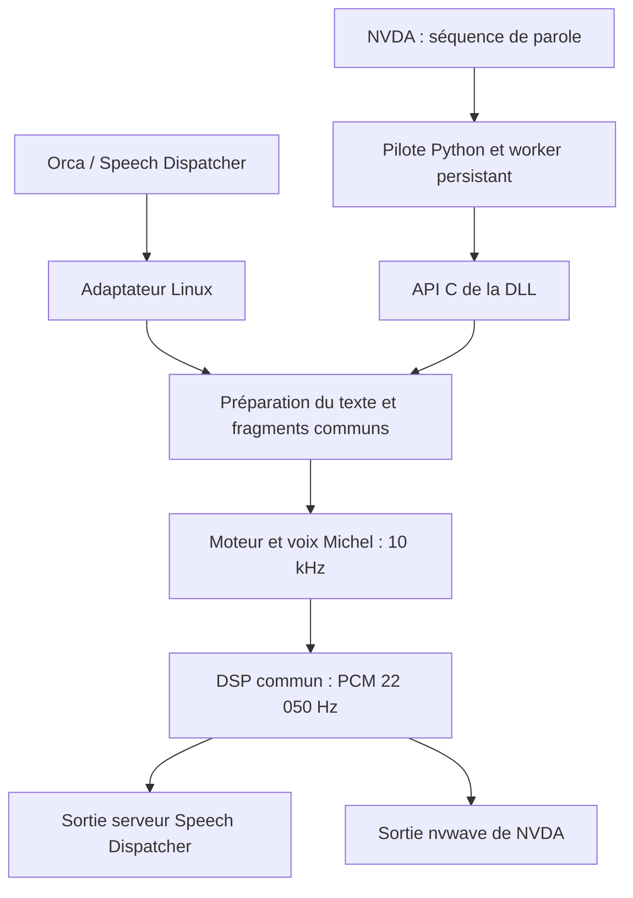

# Évolution vers Windows et NVDA

Avis et proposition d’architecture, le 26 octobre 2026. Ce document repose sur
le code actuel du dépôt et sur les sources officielles de NVDA consultées à cette
date. Il décrit un portage à réaliser ; aucun fonctionnement ni aucune latence
sous Windows ne sont encore validés. Les liens vers `master` sont évolutifs :
il faudra figer les versions NVDA retenues avant l’implémentation.

## Mon avis

**Oui, ce projet est déjà bien placé pour produire un binaire Linux et une
extension NVDA à partir du même moteur C.** Je garderais la phonétisation,
les diphones et le DSP communs, puis deux adaptateurs : Speech Dispatcher pour
Linux, pilote de synthèse NVDA pour Windows.

Sous NVDA, je recommande une DLL C chargée dans le processus, un petit pilote
Python et la sortie audio fournie par NVDA. Python fait déjà partie de NVDA :
ce pilote n’impose pas de lancer un interpréteur ni un programme externe à chaque
phrase. Tous les calculs vocaux restent en C.

La philosophie à préserver est celle d’un moteur persistant, réutilisant ses
tampons, annulable pendant le calcul, sans fichiers temporaires, sans processus
par énoncé et sans activité périodique propre au moteur lorsqu’il est au repos.
Un thread de travail persistant côté NVDA est approprié : l’absence de thread du
module Linux découle de sa boucle synchrone Speech Dispatcher et ne doit pas
conduire à bloquer la boucle principale de NVDA.

## Comment NVDA utilise une synthèse

NVDA reçoit les événements des applications par les interfaces d’accessibilité,
construit les annonces et gère leur priorité. Le pilote vocal reçoit ensuite
une séquence de parole : texte et commandes structurées. Il transforme cette
séquence en son et signale l’avancement à NVDA.

Le point d’intégration est une classe Python `SynthDriver`, dans `synthDrivers`.
Elle expose notamment `check`, `speak`, `cancel`, `pause`, les réglages et la
terminaison. Les indices et les notifications de fin sont nécessaires ; le
contrat précise aussi que `PitchCommand` est requis pour les changements de
hauteur des majuscules. Voir le [contrat officiel de SynthDriver](https://github.com/nvaccess/nvda/blob/master/source/synthDriverHandler.py).

Ici, « natif NVDA » signifie donc une extension directement sélectionnable dans
ses paramètres de synthèse, contenant le pilote Python et notre DLL native.
Il n’est pas nécessaire de créer une voix SAPI ou un service Windows. Une
interface SAPI pourrait être un autre projet pour d’autres logiciels.

Le pilote [eSpeak NG de NVDA](https://github.com/nvaccess/nvda/blob/master/source/synthDrivers/espeak.py)
illustre le traitement des commandes `IndexCommand`, `CharacterModeCommand`,
`LangChangeCommand`, `BreakCommand`, `RateCommand`, `PitchCommand` et
`VolumeCommand`. Ce sont des références d’intégration ; Synthé3 doit annoncer
uniquement les commandes qu’il prend réellement en charge.



Les deux sorties correspondent à deux constructions différentes. Le cœur ne
doit dépendre ni de Speech Dispatcher ni de NVDA.

## Ce qui est déjà partagé, et ce qu’il faut extraire

| Code actuel | Destination proposée | Travail nécessaire |
| --- | --- | --- |
| `src/engine.c`, `engine.h` | Cœur C commun | Conserver les algorithmes et les points d’annulation ; vérifier la portabilité des types et calculs |
| `src/voice_data.h` | Ressources communes intégrées | Conserver les mêmes données et leur provenance |
| `src/dsp.c`, `dsp.h` | DSP commun | Conserver filtres, arrondis, normalisations, fondus et rééchantillonnage |
| `decode`, `normalized`, `byte`, `flush` dans `module.c` | Préparation commune du texte | Séparer le découpage et la normalisation de l’audio, des marques XML et des variables globales du module |
| `render` dans `module.c` | Orchestration commune et sorties propres aux adaptateurs | Séparer moteur/DSP, calcul des positions et livraison du PCM |
| Réglages dans `module.c` | Paramètres moteur communs, conversion par adaptateur | Distinguer les unités internes des échelles Speech Dispatcher et NVDA |
| `walk`, libxml2, `module_*`, protocole et `poll_input` | Adaptateur Linux | Garder le SSML et la gestion Speech Dispatcher ici |
| Nouveau pilote Python et couche d’export C | Adaptateur NVDA | Ajouter file de travail, commandes NVDA, audio et notifications |

`build/libsynthe3.a` contient déjà seulement `engine.o` et `dsp.o`. C’est une
base utile, mais elle ne comprend pas la préparation Unicode ni le découpage.
Le `Makefile` actuel interroge aussi les dépendances Linux : il faudra des cibles
permettant de construire le cœur et la DLL sans Speech Dispatcher ni libxml2.

Je proposerais une organisation de ce type, sans imposer de déplacement immédiat
des fichiers existants :

```text
src/core/           moteur, DSP, voix, préparation du texte et marques
src/api/            interface C exportée et versionnée
src/speechd/        protocole Linux, SSML et sortie serveur
nvda/addon/         manifest.ini, synthDrivers/, DLL, documentation et licences
tests/             références communes et tests propres aux adaptateurs
```

Le traitement commun doit accepter du texte et des marques abstraites, sans
`xmlChar`, `SPDMessageType` ou objet Python. Une marque NVDA ne doit pas obliger à
couper un fragment : le module Linux évite déjà cette régression sonore.

### Texte, ponctuation et réglages

Le moteur accepte **240 octets Latin-1 par fragment**, pas 240 caractères Unicode.
Le pilote peut transmettre de l’UTF-8 à la couche commune, qui applique les mêmes
règles que Linux, notamment `œ → oe` et les apostrophes typographiques. Il faut
maintenir la correspondance entre frontières du texte source et octets produits :
les indices ne peuvent pas être calculés après une conversion naïve qui change
les longueurs. Tester aussi les accents décomposés et décider explicitement de
leur normalisation.

NVDA prépare déjà une partie des symboles et prononciations. Sa voie d’entrée
doit éviter de redoubler l’expansion de ponctuation de `append_text`. Le mode
caractère reste une instruction distincte, à tester dans la saisie et l’épellation.
La voix Michel reste française : ne pas déclarer un changement de langue effectif
sans moteur correspondant.

Pour le débit et la hauteur, conserver les niveaux internes 0 à 15 et définir une
conversion NVDA 0 à 100. La courbe Linux actuelle est calibrée pour son usage avec
Orca ; copier ses nombres ne garantit pas le même confort dans NVDA. Préserver
la hauteur moteur par défaut 5 et le gain fixe 0 dB. La modulation facultative
peut devenir le réglage d’inflexion, avec une correspondance documentée et
la double passe désactivée par défaut.

Attention au volume : `s3_process` utilise actuellement l’échelle Speech Dispatcher
−100 à +100, où 0 est le gain unitaire et −100 le silence. Passer directement un
volume NVDA 0 à 100 donnerait une erreur audible. Définir une conversion ou une
interface interne à gain linéaire, puis appliquer le volume utilisateur à un seul
endroit.

## API C et exécution Windows

Je commencerais avec une API C mince, synchrone, sans thread interne : initialiser,
préparer/rendre un fragment, récupérer ses marques, demander une annulation et
libérer. Le worker NVDA en est l’unique appelant pour les opérations de rendu.
Seule la demande d’annulation est accessible concurremment.

L’interface doit préciser :

- Version ABI, convention d’appel et exports Windows explicites.
- Tailles et types entiers définis, longueurs explicites, codes distincts pour
  succès, erreur et annulation.
- Propriété des tampons et durée de validité : les pointeurs PCM actuels
  appartiennent au moteur/DSP et sont réutilisés. Copier ou terminer leur
  consommation avant le rendu suivant ; libérer dans la bibliothèque qui alloue.
- Annulation consultée en C, via un état atomique ou une primitive adaptée,
  indépendante du thread principal Python.

Les états globaux du moteur et du DSP rendent le code non réentrant. Une seule
instance et un seul worker suffisent pour la première extension. Une API à
contexte opaque prépare une évolution future, mais ne rend pas magiquement les
variables globales indépendantes : une vraie prise en charge de plusieurs
instances exige de les déplacer.

Charger la DLL avec `ctypes.CDLL`, en déclarant les signatures, permet de libérer
le GIL pendant les appels C. Éviter un callback Python à chacun des points de
contrôle : l’annulation doit rester une lecture native légère. Le
[pont eSpeak existant](https://github.com/nvaccess/nvda/blob/master/source/synthDrivers/_espeak.py)
fournit un exemple officiel de DLL, file et thread persistant dans NVDA.

La DLL doit correspondre à l’architecture du **processus NVDA ciblé**, pas
simplement à celle de Windows. Figer une matrice de versions et d’architectures
supportées, construire les bibliothèques correspondantes et les charger par
chemin absolu depuis l’extension. Une API C évite de lier le moteur à l’ABI d’une
extension CPython compilée.

Auditer les différences C entre Linux et Windows, notamment `long` en LP64/LLP64,
les conversions signées, les tailles et les produits d’indices. Préserver le
`char` signé attendu, l’absence de contraction flottante et les arrondis au pair.
GCC/MinGW ou Clang peuvent faciliter la première construction ; MSVC demandera
ses options équivalentes. L’identité PCM entre compilateurs et bibliothèques
mathématiques doit être mesurée, même avec les mêmes sources.

## Faible latence : les points déterminants

### Sortie audio

Je commencerais avec `nvwave.WavePlayer`, en PCM mono 16 bits à 22 050 Hz, et le
périphérique configuré dans NVDA. Cette couche utilise WASAPI. Sa méthode `feed`
peut bloquer lorsqu’il manque de place, et propose `onDone` à la fin de lecture
d’un bloc ; elle expose aussi `stop`, `pause` et la synchronisation. Voir
[l’implémentation officielle de nvwave](https://github.com/nvaccess/nvda/blob/master/source/nvwave.py).

Une sortie WASAPI propre à Synthé3 ne serait justifiée qu’après des mesures
montrant un problème dans cette voie. Elle ajouterait la gestion des périphériques,
des changements de sortie et de la coordination audio avec NVDA.

Les paquets Linux de 1 024 échantillons représentent environ **46,4 ms d’audio**.
Cela ne prouve pas une latence d’arrêt de 46,4 ms : une sortie peut purger les
échantillons en attente. Tester sous Windows plusieurs tailles de livraison,
par exemple 128, 256, 512 et 1 024 échantillons, en mesurant aussi les coupures
et le coût des appels. Un petit paquet ne garantit pas un petit tampon matériel.

### Annulation et courses entre threads

`speak` doit mettre le travail en file et revenir rapidement. Le worker dort
sur une attente bloquante au repos ; il prépare et calcule les fragments en C.
Il faut limiter le travail et le PCM préparés en avance, notamment pendant une
pause. Les messages `speak` successifs doivent respecter l’ordre demandé par
NVDA : une nouvelle soumission n’annule pas automatiquement la précédente.

`cancel` doit invalider le travail courant, retirer les énoncés en attente et
arrêter la sortie audio **sans attendre que le worker finisse son calcul ou son
`feed` bloquant**. Un verrou gardé pendant ces opérations empêcherait l’arrêt.

Attribuer un numéro de génération aux travaux et callbacks permet d’ignorer les
anciens résultats et notifications. Mais ce numéro seul ne suffit pas : un
ancien `feed` pourrait encore démarrer après la purge. Définir et tester une
coordination qui empêche ou repurge cette livraison tardive, sans éliminer le
début du nouvel énoncé. C’est un des points essentiels du prototype.

La pause doit conserver la position audio et empêcher une production illimitée
de fragments ; la reprise continue le même travail. Elle ne doit pas reprendre
automatiquement la logique Linux d’arrêt au prochain marqueur `__spd_`.
La terminaison annule, réveille le worker, attend sa sortie puis libère le
moteur et le lecteur, sans callback vers une instance détruite.

### Premier son et indices

Le moteur rend aujourd’hui un fragment entier avant émission ; le DSP recherche
ses crêtes avant normalisation. C’est déjà rapide sous Linux et préserve le son.
Je conserverais ce comportement pour le premier portage. Un véritable rendu
échantillon par échantillon modifierait cette stratégie et demanderait une
validation sonore séparée. Réduire arbitrairement les fragments change aussi
les normalisations, les fondus et potentiellement la prosodie.

Le budget de 2 ms de `poll_input` appartient à la lecture des commandes Linux.
Sous Windows, conserver les points de contrôle du moteur, avec une consultation
native de l’annulation ; aucun timer de 2 ms au repos n’est nécessaire.

Pour chaque `IndexCommand`, relever la position via `s3_sample_at`, convertir
10 000 → 22 050 Hz et associer la notification au passage audio correspondant.
Les positions actuelles restent approximatives aux frontières des diphones.
Ne pas annoncer les indices dès le calcul terminé, ni la fin dès la dernière
livraison de PCM. Le pont eSpeak cité plus haut montre le principe de callbacks
liés à la lecture. Prévoir les indices au début, plusieurs indices à la même
position, les séquences sans audio et l’invalidation après annulation.

## Progression conseillée

État sur la branche `nvda` : la phase 1 extrait la préparation du texte et les
marques dans `src/text.c` / `src/text.h`, avec livraison par callbacks, et ajoute
les cibles `core` et `test-core`. Le module Linux utilise cette interface ;
SSML, protocole, conversion des réglages et livraison du PCM restent dans
l’adaptateur. Le moteur et le DSP ne changent pas. La phase 2 ajoute l’API C exportée et la construction de la DLL x64 ; voir
[le contrat et le banc de rendu](docs/windows-api.md). L’orchestration audio
Windows et le pilote NVDA appartiennent à la phase suivante.

1. **Extraire sans changer le son.** Isoler préparation du texte, fragments et
   marques. Garder l’adaptateur Linux fonctionnel et passer ses tests existants.
2. **Construire la DLL et un petit banc de rendu Windows.** Vérifier les
   références PCM, les réglages, les erreurs et l’annulation sans dépendre de NVDA.
3. **Créer l’extension NVDA minimale.** Voix Michel française, débit, hauteur,
   volume, indices, notifications, annulation et pause/reprise. Ajouter les
   commandes de prosodie effectivement gérées et le mode caractère.
4. **Mesurer dans NVDA.** Navigation rapide, saisie, lecture continue, changements
   de focus, rafales annulation/reprise, changement de synthèse et de sortie audio.
5. **Optimiser à partir des mesures.** Taille des paquets, préparation anticipée
   bornée et allocations ; réserver toute modification du DSP à une étape séparée.

Pour le paquet, fournir un `.nvda-addon` avec manifeste, pilote dans
`synthDrivers`, DLL, documentation et licences. Déclarer les versions minimale
et dernière testée selon les essais réellement réalisés, conformément au
[guide officiel des extensions NVDA](https://download.nvaccess.org/documentation/developerGuide.html).
Conserver les mentions LGPL du moteur, GPL du DSP et du module, ainsi que la
provenance des données Michel décrite dans [LICENSE.md](LICENSE.md) et
[UPSTREAM.md](UPSTREAM.md).

## Validation attendue avant de parler de performances équivalentes

| Mesure ou essai | Ce qu’il doit vérifier |
| --- | --- |
| Références vocales existantes | Conserver les 40 cas historiques avec leurs anciens réglages et les tests des réglages courants |
| PCM Linux/Windows | Comparer durée, échantillons et empreintes ; analyser toute divergence avant de tolérer un écart |
| Premier audio | Séparer mise en file, calcul du premier fragment, livraison et début audio observé |
| Annulation | Mesurer séparément abandon CPU, purge audio et fin du son observé |
| Rafales arrêt/reprise | Aucun ancien échantillon ou indice après annulation ; nouvel énoncé intact |
| Lecture continue | Indices et fin synchronisés avec l’audio, sans dérive ni notification obsolète |
| Pause et sortie | Reprise à la bonne position, comportement correct après changement de périphérique |
| Repos | Worker bloqué, absence de polling propre à Synthé3, CPU et mémoire stables |

Relever médiane, p95 et maximum, à froid puis à chaud, avec versions, machine,
périphérique et taille des blocs. Une capture loopback situe la sortie dans la
pile audio ; une mesure physique reste nécessaire pour inclure le périphérique.
Les chiffres Linux du dépôt concernent notamment des notifications : ils ne sont
pas directement comparables à une mesure acoustique Windows.

**Ma recommandation est de commencer par la DLL du cœur existant, le pilote NVDA
minimal et sa gestion d’annulation.** Le moteur rapide est déjà là ; la réussite
du portage dépendra surtout de la file audio et de la synchronisation avec NVDA.
